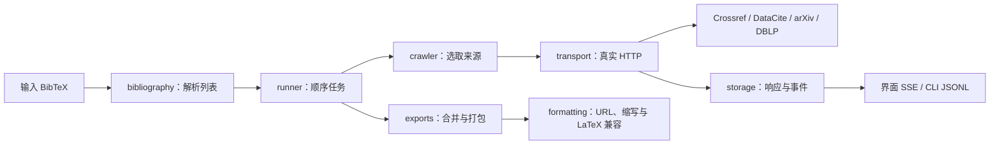

# 架构与抓取规则

[返回首页](../README.md)

## 数据流

浏览器只展示状态并调用本机 API；网络检索在 Python 端执行。GUI 与 CLI 共用 Runner、Crawler 和导出模块，前端没有另实现一套抓取过程。

## 抓取与选取规则

只请求任务中已启用的来源。每个输入条目按以下顺序尝试，取得可解析且满足标题匹配规则的单条来源 BibTeX 后停止本条检索：

1. 有 arXiv 编号：下载 arXiv 提供的 BibTeX。
2. 有 DOI：尝试 Crossref BibTeX 内容协商，再尝试 DataCite 内容协商。
3. 有 DBLP 记录链接：下载对应 `.bib`。
4. 按输入标题依次查询 Crossref → DBLP → arXiv，每个来源最多返回 5 个候选。
5. 仅选择规范化后标题一致的唯一记录；多个不同下载地址同名时记录歧义，没有同名结果时记录未匹配。两者都继续下一个来源，不回退到首条。
6. 下载后重新读取 BibTeX 的 `title`。输入有标题时必须一致；标题缺失或不一致则保存响应、记录拒绝并继续下一个来源。该规则同样约束标识符直取和缓存响应。
7. 输入没有标题时仅走已有标识符／记录链接路径，并记录 `title_unavailable`；所有路径失败时记录失败原因，继续下一个输入条目。

DataCite 只作为 DOI 下载补充，不参与标题搜索。不从 JSON 搜索元数据生成 BibTeX；JSON/XML 仅用于找到来源下载地址。代码不做作者、年份或语义相似度核验。

`matching.py` 提供独立的保守标题规范化，不使用期刊缩写的宽松规范化函数。它保留关键符号、数字、重音、副标题和数学内容，未知 TeX 命令也不会悄悄丢弃。规范与历史任务处理见[标题匹配](TITLE_MATCHING.md)。

## HTTP 与事件

- 全部请求使用 HTTPS，仅允许已支持来源的域名及标准 HTTPS 端口。
- 同一主机请求至少间隔 1.1 秒；arXiv 主机至少间隔 3.1 秒。
- 连接超时 10 秒，常规 HTTP 操作超时 20 秒；这不是单条文献的总时长上限。
- 临时网络错误、429 和部分 5xx 最多重试一次。短 `Retry-After` 被遵循，超过 25 秒记录失败以便之后重试。
- 跳转链最多处理 5 次请求；每次请求、响应、跳转均独立记录。
- 解压后的响应正文限制为 4 MB，按 UTF-8 严格解码。
- 缓存有效期 24 小时，只有启用缓存时才读取；每次成功响应仍保存到本机。缓存事件不增加请求计数。

事件来自实际执行点：发起请求前写入 `request`，收到完整响应后写入 `response`。无完整响应的连接错误不会伪装成响应或“搜索无结果”。来源失败页面也保存正文供查看；超出大小限制或无法解码的内容不会保存成完整正文。

## 存储与任务

SQLite 使用 WAL。每次条目变化持久化任务 JSON，事件按任务内递增序号存储，响应正文以 SHA-256 为键保存。本机数据库名沿用 `cleanroom.sqlite3`。

任务状态：`ready` → `queued` → `running` → `done`；停止后为 `cancelled`，重启发现残留运行状态时为 `interrupted`。条目状态为 `pending`、`processing`、`success`、`failed`。

本工具面向一个本机服务进程。一个实例内的任务串行执行；多实例应使用不同数据目录。

## 导出约定

来源 BibTeX 保留为原文。合并文件执行用户选定的引用键、URL、venue 格式处理，并自动通过 `latex_compat.py` 规范月份宏、重音字母、Unicode 标点与普通文本特殊字符。已有数学片段、TeX 转义与 URL／DOI 标识不重复转义。不推断或补写文献元数据。字段修改前后记录到 `formatting.json`，引用键关系写入 `key-map.csv`。导出不会修改已保存的下载原文。

默认 `include_unfetched=true`：未抓取成功的行从已解析输入中保留全部字段，展开输入字符串宏，并经过同一格式流程；输出注释和 `export-summary.json` 标明输入来源。下载状态与 HTTP 日志不变。关闭该选项时省略这些行。`downloaded.bib` 始终仅含成功条目，不会把被拒绝的响应作为后备内容。

输入重复引用键会获得唯一内部键；合并时再次处理来源键冲突。不同输入对应同一篇文章时不会去重。

## 代码目录

| 模块 | 职责 |
| --- | --- |
| `bibliography.py` | BibTeX 解析、宏处理、标识提取、标题规范化 |
| `crawler.py` | 路由、标题候选、来源 BibTeX 下载 |
| `transport.py` | HTTP、节流、重试、跳转、实际事件 |
| `runner.py` | 顺序执行、状态转换、停止与持久化 |
| `storage.py` | SQLite 任务、响应、缓存、事件 |
| `formatting.py` | 在原文上定位字段并执行用户选定的修改 |
| `latex_compat.py` | 合并导出必经的 BibTeX／LaTeX 语法兼容处理 |
| `abbreviations.py` | 缩写定义、明确别名、会议名称归一化 |
| `exports.py` | 合并文件、报告与 ZIP |
| `app.py` | FastAPI、本机访问约束、SSE、静态资源 |
| `launcher.py` | 本机 GUI 启动、端口、数据目录 |
| `__main__.py` | CLI，保留 `python -m bibclean` 入口 |
| `config.py` | 安装包资源位置、跨平台用户数据路径 |
| `static/` | HTML、CSS、JavaScript，无前端构建步骤 |
| `resources/sample.bib` | 随安装包分发的公开输入示例 |

内部 Python 包名保留为 `bibclean` 以兼容已有命令，分发包名与界面名为 BibTeX Fetch。
